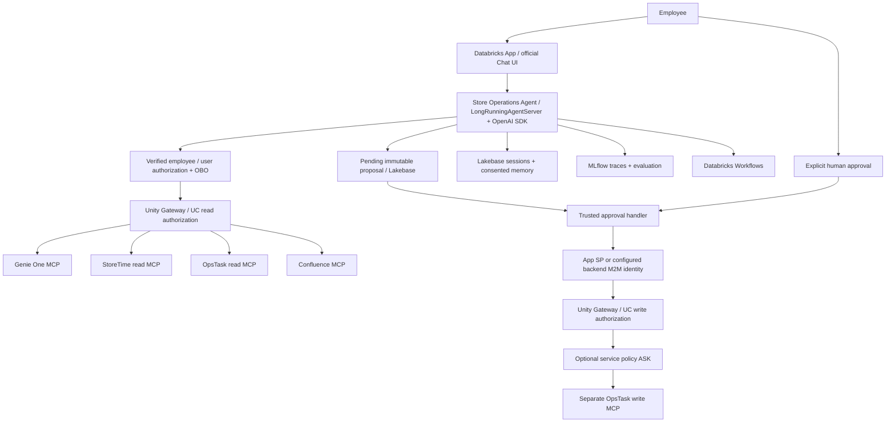

# Databricks Store Operations Agent

A portable customization of the **official Databricks OpenAI Agents SDK advanced/multiagent templates**, pinned to upstream commit `0e572976459aafa3d41047067382cb9a6c015d52`. See [template provenance](docs/TEMPLATE_PROVENANCE.md), LICENSE and NOTICE.

The handwritten FastAPI demo and hard-coded store metrics have been removed. The application uses the template's MLflow Responses API, `LongRunningAgentServer`, official chat UI, native `AsyncDatabricksSession`, Databricks model authentication and governed MCP integrations. There is **no synthetic runtime fallback**; scripted models and synthetic agent transports are confined to `tests/`. Explicit synthetic business MCP applications are isolated in `mcp-apps/`.

## Architecture



Interactive reads retain employee OBO identity. The privileged writer is constructed only after an employee/session-bound approval is claimed, using app or dedicated backend OAuth identity. Production OpsTask read/write services have distinct bindings; the model and browser receive no writer credentials. UC controls who can call a service; application approval controls the particular mutation. Optional Gateway `ASK` adds defense in depth, subject to platform support. See [identity modes, least-privilege grants and scope configuration](docs/GOVERNANCE.md). The default bundle uses the App SP; a dedicated M2M principal requires separate secret bindings and its own grants.


| Capability | Contains / allowed | Excluded |
| --- | --- | --- |
| **Genie One MCP** | Governed store metrics, region, training completion, scheduled/completed hours, wait time; analytics, comparisons, completion tables | Task creation, schedule updates, approvals, policy |
| **StoreTime MCP** | Read-only schedules, protected training blocks, completed/converted hours, coverage reasons; training diagnostics | Schedule changes, task creation |
| **OpsTask MCP** | Follow-up lookup; mutation only after a separate human approval command | Silent creation; diagnosing root cause alone |
| **Confluence MCP** | Governed company context and policy, citing retrieved sources | Invented or uncited policy |

Each specialist receives only its own MCP server. Read tool names are audited allowlists, enforced both when listing tools and immediately before dispatch. Mutating names are rejected in read views. Genie uses `/api/2.0/mcp/genie/{GENIE_SPACE_ID}`; external capabilities use workspace-governed UC connection routes. MCP schemas are discovered from the live server, not reimplemented as fictional APIs. The separate task writer validates its mapped arguments against the actual deployed MCP JSON schema.

Policy answers must cite identifiers/URLs present in actual Confluence results and supply substantive exact excerpts found in the retrieved text. The application delivers those verified excerpts instead of model-authored policy prose, or abstains. This establishes source provenance and quotation fidelity; relevance and semantic entailment are further assessed by the evaluation groundedness/policy judges. Source permissions must still be enforced by Unity Gateway/Unity Catalog and upstream services.

## Reconstructed local MCP demo

The original uncommitted MCP layer was lost. `mcp-apps/` is a **functional reconstruction from the documented specification**, not a recovered snapshot. It contains separate synthetic StoreTime, OpsTask and Confluence services; Genie remains Databricks-provided. See [exact contracts](mcp-apps/CONTRACTS.md), [service setup](mcp-apps/README.md) and [fresh reconstruction evidence](docs/validation/DEMO_E2E_REPORT.md).

Local startup order:

1. `uv sync --locked`.
2. `uv run python -m scripts.validate_demo_stack` starts three temporary MCP processes, checks health/readiness and initialization, compares runtime schemas, exercises all read tools, and verifies read-credential mutation denial.
3. `uv run python -m tests.demo_e2e_validation` runs real SDK/application handlers against those services with explicitly test-only model, Genie, identity and memory fixtures; it writes fresh evidence under `docs/validation/reconstruction/`.
4. For interactive services, copy each `mcp-apps/<service>/.env.example` to its ignored `.env`, generate distinct read/write tokens, and run the three `demo-*` commands described in the service README. Ports are 8101, 8102 and 8103, with `/mcp`, `/health`, `/ready`.
5. Configure the agent's matching `.env.demo.example` values in an ignored local configuration. `MCP_CONNECTION_MODE=local_demo` only permits loopback URLs for these three services; `deployed_demo` requires HTTPS and exact `DEMO_MCP_ALLOWED_HOSTS`. Genie retains its authenticated workspace route in every mode.
6. Start the actual Chat UI/Agent Server only after supplying real Genie, model, employee authentication and Lakebase/App bindings. No credential-free production agent fallback is added. The agent's launcher loads `.env`; the separate service commands use their own env files.

The explicitly selected demo services use synthetic JSON/Markdown and demo-only SQLite task storage. Production agent sessions/approvals still require Lakebase. The OpsTask model-facing client gets read credentials only; the separate human-approval handler supplies the write credential. A write credential is sufficient for direct server mutation, so it must remain backend-only. These local credentials simulate roles, not live Databricks authorization.

## Build and verify without a workspace

Prerequisites: Python 3.12, Node 22+, npm, `uv` (0.9.17+).

```bash
uv sync --locked
uv run pytest -q
npm ci --prefix e2e-chatbot-app-next
npm run build --prefix e2e-chatbot-app-next
uv build --wheel
```

Tests run real SDK orchestration with scripted models and test-only MCP transports. They validate boundaries, proposal/approval/rejection, identity scoping, Lakebase adapter contracts, workflow SDK calls, Responses streaming shape, runtime construction, evaluation scorers and local MLflow trace readback. They do not require Databricks credentials. Live checks are marked `integration` and skipped unless explicitly opted in **and** their required configuration is present.

There is no credential-free production server mode. Missing configuration fails clearly at startup; it does not return synthetic analytics. See [validation levels](docs/VALIDATION.md).

## Supply configuration later

Copy `.env.example` to an ignored `.env`, or bind values through Databricks Apps resources/secrets or CI. Local startup loads `.env` before importing the agent, as in the official template. All workspace/resource identities remain configurable; no source edits are required.

| Setting | Value to supply |
| --- | --- |
| `DATABRICKS_HOST` | `https://<workspace-host>` |
| `DATABRICKS_CONFIG_PROFILE` | `<databricks-profile>` for local CLI/SDK use |
| `DATABRICKS_APP_NAME` | Platform-injected deployed app name; leave unset for local profile development |
| `MODEL_ENDPOINT` | `<model-serving-endpoint>` (Databricks-hosted, OpenAI-compatible chat completions) |
| `LAKEBASE_ENDPOINT` | `<autoscaling-endpoint-resource-path>`; alias for upstream `LAKEBASE_AUTOSCALING_ENDPOINT` |
| `GENIE_SPACE_ID` | `<genie-space-id>` |
| `GENIE_MCP_URL` | Optional `https://<workspace-host>/api/2.0/mcp/genie/<genie-space-id>` |
| `STORETIME_CONNECTION`, `OPSTASK_READ_CONNECTION`, `CONFLUENCE_CONNECTION` | `<uc-connection-name>` for each external MCP service |
| `STORETIME_MCP_URL`, `OPSTASK_MCP_URL`, `CONFLUENCE_MCP_URL` | Optional full workspace UC gateway route overrides |
| `STORETIME_READ_TOOLS`, `OPSTASK_READ_TOOLS`, `CONFLUENCE_READ_TOOLS` | Actual audited, comma-separated read-only tool names discovered from deployed MCP schemas |
| `OPSTASK_CREATE_TOOL` | Actual task mutation tool name, never exposed to the model |
| `OPSTASK_ARGUMENT_MAP`, `OPSTASK_RESULT_ID_FIELD` | Provider-specific argument/result field mappings; validated against discovered schema |
| `DATABRICKS_WORKFLOW_JOB_ID` | `<workflow-job-id>`; bundle binds its background evaluation job by default |
| `MLFLOW_EXPERIMENT_ID` | `<experiment-id>` bound to the chosen UC trace location |
| `MLFLOW_TRACING_SQL_WAREHOUSE_ID` | `<sql-warehouse-id>` for UC trace provisioning/readback |
| `STORE_OPS_SCHEMA`, `LAKEBASE_AGENT_MEMORY_SCHEMA` | `<lakebase-schema>` for app tables and SDK session tables; keep them consistent |

`LAKEBASE_ENDPOINT` means the Databricks autoscaling **resource path** expected by the pinned SDK, not a raw PostgreSQL host. The Lakebase library discovers connection details and rotates OAuth credentials. No static DSN/password or SQLite path is used. Upstream SDK TLS defaults remain enabled.

Full MCP URL overrides are restricted to the authenticated workspace's HTTPS origin and capability-appropriate gateway paths. This prevents forwarding employee OAuth credentials to arbitrary URLs. For non-workspace external servers, register a UC connection and use the workspace gateway; do not point these settings directly at third-party hosts.

Discover real schemas when the workspace is available:

```bash
uv run python -m scripts.inspect_mcp --profile '<databricks-profile>' \
  --path '/api/2.0/mcp/external/<connection-name>'
```

Environment variables are bindings, **not evidence that a service is connected**. No deployment or live connectivity is claimed from configuration alone.

## DEV deployment

1. Install the current Databricks CLI and authenticate to your chosen profile. Always pass `--profile` so commands cannot silently target a different workspace.
2. Provision/select the Genie Space, three UC MCP connections, Lakebase endpoint/branch/database, model and judge endpoints, cluster for evaluation jobs, SQL warehouse and MLflow experiment. Apply the grants in [governance](docs/GOVERNANCE.md). Resource creation remains an operator action; placeholders are deliberate.
3. Populate ignored local environment values. Apply the additive SQL schema using a migration identity:

   ```bash
   uv run python -m scripts.migrate
   ```

   The native session tables are initialized during agent startup. Grant only required SQL access to the app principal; see `scripts/grant_lakebase_permissions.py` and governance notes.
4. Choose an existing UC trace schema explicitly and bind the experiment (this provisions trace tables):

   ```bash
   uv run python -m scripts.configure_traces --profile '<databricks-profile>' \
     --experiment-id '<experiment-id>' --catalog '<catalog>' --schema '<schema>'
   ```

   The script discovers a SQL warehouse if none is specified. An experiment already bound elsewhere is rejected. No arbitrary catalog/schema is selected, and there is no fallback to ungoverned legacy trace storage.
5. Supply DAB variables from `config/dev.env.example` via `BUNDLE_VAR_*` environment variables or an ignored `databricks.local.yml`. Examples:

   ```bash
   export BUNDLE_VAR_workspace_host="$DATABRICKS_HOST"
   export BUNDLE_VAR_app_name="$DATABRICKS_APP_NAME"
   export BUNDLE_VAR_lakebase_endpoint="$LAKEBASE_ENDPOINT"
   export BUNDLE_VAR_genie_space_id="$GENIE_SPACE_ID"
   # Set the remaining documented BUNDLE_VAR_* bindings too.
   databricks bundle validate -t dev --profile '<databricks-profile>'
   databricks bundle deploy -t dev --profile '<databricks-profile>'
   databricks bundle run store_operations -t dev --profile '<databricks-profile>'
   ```

   Run startup with `uv run start-app` for local authenticated development; `USER_AUTHORIZATION_MODE=local_profile` together with `ALLOW_LOCAL_PROFILE_IDENTITY=true` explicitly permits the verified CLI profile identity outside Databricks Apps. Production requests require a forwarded employee token validated against Databricks `/Me`.
6. Enable Databricks Apps user authorization and required workspace/data scopes. Verify cross-employee/store access, source retrieval, an approval/rejection cycle and the Workflow job before using employee data.

The `dev` and `prod` targets share the same variable contract and differ in DAB deployment mode. Supply different values and principals for each environment; the app source does not change. See `config/prod.env.example`. Do not copy DEV credentials to PROD.

## Human actions and memory

The official chat UI includes a task-review panel. The model's `propose_task` stores the exact title, store, assignee and due date in Lakebase and returns a pending proposal. Only a separate employee command may claim that proposal and invoke the mutation tool. Rejection is permanent; approval replays cannot issue a second write. An ambiguous outcome becomes `needs_reconciliation`; a crash can leave `executing`. Reconcile by approval ID with OpsTask rather than resetting/retrying. The provider must honor the mapped idempotency key and enforce row/store permissions.

The native Responses endpoint `/invocations` accepts `custom_inputs.action`:

| Action | Additional fields | Effect |
| --- | --- | --- |
| `chat` (default) | `session_id` | SDK orchestration using employee/session-scoped Lakebase history |
| `pending_proposals` | `session_id` | List proposals visible to that employee/conversation |
| `task_decision` | `session_id`, `approval_id`, `approve: true/false` | Explicit human approval/rejection |
| `remember` | `content`, `consent: true` | Opt-in employee-scoped long-term preference |
| `memories` / `forget` | `memory_id` for deletion | Inspect/delete the employee's preferences |
| `clear_session` | `session_id` | Delete the current conversation's native SDK session |
| `workflow_submit` | `request_id`, `confirm: true` | Submit the fixed Databricks evaluation Workflow |
| `workflow_status` | same `request_id` | Retrieve the recorded employee-owned run's state |

Only the latest user message is accepted as new chat input. The server loads prior history from Lakebase and ignores client-supplied historical tool/assistant authority. Identity comes from the verified token, never a supplied `user_id`. PostgreSQL advisory locks serialize turns per employee/conversation. Short-term history includes real SDK messages and tool results. Long-term preferences are explicitly consented, deletable, and treated as untrusted context rather than policy.

## MLflow evaluation and Workflows

`evaluations/datasets/store_operations.jsonl` contains analytics, diagnostics, policy and adversarial approval/boundary cases. `evaluations/scorers.py` defines tool-selection, task-approval safety and policy-provenance scorers, plus MLflow groundedness, policy-compliance, response-quality, relevance and fluency judges.

```bash
uv run agent-evaluate --judge-model 'databricks:/<judge-serving-endpoint>'
```

This executes the actual agent against configured resources and logs trace-linked evaluations. It is intentionally a live operation, not a canned fixture evaluation. The DAB job runs the same packaged suite on a configured Databricks cluster. Jobs API submission uses a stable employee-scoped idempotency token; job status is owner-scoped. The fixed job performs evaluations and can create review proposals, but never approves or mutates OpsTask. Configure an evaluation-safe data scope and model budget before scheduling it.

## Omnigent, Codex and validation limits

See [OMNIGENT_SETUP.md](OMNIGENT_SETUP.md) for the team-specific harness handoff. No authoritative Omnigent schema was available in the pinned public template, so no fabricated config is claimed as valid. Codex repository guidance is in `AGENTS.md`; a standard VS Code launch configuration supports debugging the actual Agent Server entry point.

Local verification and live verification are distinct. [docs/VALIDATION.md](docs/VALIDATION.md) records the checks and gaps. Actual Databricks deployment, UC/Unity Gateway grants, Lakebase persistence, external MCP schemas and mutations, MLflow workspace export/judges and Workflow execution require a configured workspace and have not been certified by local tests.

## Enterprise writer configuration

Keep `USER_AUTHORIZATION_MODE=obo` in deployed Apps. Supply distinct `OPSTASK_READ_CONNECTION` and `OPSTASK_WRITE_CONNECTION`, optional distinct read/write URL overrides, and `OPSTASK_WRITE_OAUTH_SCOPES` selected for the supported endpoint. `OPSTASK_WRITE_AUTH_MODE=app` uses the App's injected OAuth credentials; `m2m` uses backend-only `OPSTASK_WRITE_CLIENT_ID` and secret-bound `OPSTASK_WRITE_CLIENT_SECRET`. The writer never reuses the employee client. DEV and PROD examples use the same variable names with separately supplied values.

Mode A uses `OPSTASK_APPROVAL_MODE=application`. Mode B uses `application_and_gateway_ask` plus `OPSTASK_GATEWAY_POLICY_ID`, after an administrator attaches a supported policy. These variables do not create a policy or grant access. No live Gateway challenge/resume interaction is certified by local tests.

The reconstruction checkpoint and its evidence remain under `docs/validation/reconstruction/`. Post-refactor validation uses a separate directory so that history is preserved. Both runs use test-only model/Genie/identity/memory fixtures around real local MCP traffic; neither proves live Databricks integration.
