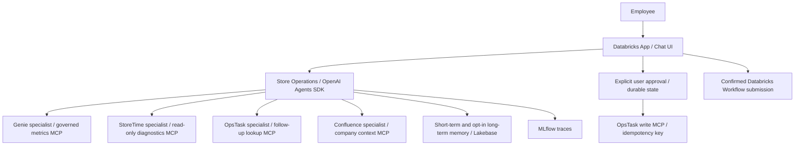

# Fieldwork · Store Operations Agent

Store-operations chat application built with **OpenAI Agents SDK**, FastAPI and a responsive browser UI. Run a synthetic demo locally, or configure live MCP, Databricks identity, Lakebase, Workflows and MLflow integrations.

## Quick start

Python 3.12+:

```bash
python -m venv .venv
.venv/bin/python -m pip install -r requirements.lock
.venv/bin/python -m pytest -q
.venv/bin/uvicorn app.main:app --host 0.0.0.0 --port 8000
```

Open the app on port 8000 in your development environment. `APP_MODE=demo` is the default. All demo store data is explicitly synthetic; demo chat is deterministic and makes no model calls. The UI supports analytics, training diagnostics, follow-up lookup, proposals, approval and rejection. SQLite at `/tmp/store-operations.db` retains local history, preferences, approvals and tasks. Recreating it removes local data. Demo session identifiers are not employee authentication.

## Architecture and boundaries



| Tool | Contains / can do | Cannot do |
| --- | --- | --- |
| Genie | Governed metrics, region, training completion, scheduled/completed hours, wait time; analytics, comparisons and tables | Tasks, schedule updates, approvals, policy |
| StoreTime | Schedules, protected blocks, completed/converted hours, coverage reasons; training root-cause diagnostics | Change schedules or create tasks |
| OpsTask | Look up follow-ups; create a task after explicit approval | Silent creation; root-cause diagnosis alone |
| Confluence | Retrieved company context with citations | Invent policy or authorize actions |

Live orchestration exposes four specialists as tools to a supervisor. Each specialist sees only its own MCP server and an administrator-configured tool allowlist. No task-write tool is available to the model. Live providers must still enforce store-level data access and read-only permissions server-side; allowlists select tool names, not argument-level authorization.

## Configuration

See [.env.example](.env.example) for variable names. It is documentation only; the app does not automatically load this file. Supply secrets through secure environment bindings, never source control.

- `APP_MODE=live`, `OPENAI_API_KEY`, optional `OPENAI_MODEL` (default `gpt-4.1`).
- `GENIE_MCP_URL`, `STORETIME_MCP_URL`, `OPSTASK_READ_MCP_URL`, `CONFLUENCE_MCP_URL`: Streamable HTTP HTTPS endpoints.
- Each endpoint requires an explicit comma-separated `<PREFIX>_TOOLS` allowlist and optionally its own `<PREFIX>_TOKEN`. For example `GENIE_MCP_TOOLS=query_store_metrics` and `GENIE_MCP_TOKEN`. Tool names are deployment-specific; example names are not assumed real APIs.
- `DATABRICKS_HOST`: workspace HTTPS origin. Live API calls require a Databricks user token in `X-Forwarded-Access-Token`; the backend verifies it through workspace SCIM `/Me` and scopes data to the returned identity. Enable and validate Databricks Apps user authorization and required scopes. Do not substitute an unverified employee header.
- `LAKEBASE_DSN`: PostgreSQL connection string supplied securely. Live storage requires it. Connections enforce `sslmode=verify-full`; configure the trusted CA with `PGSSLROOTCERT` when needed. Development uses SQLite. Provide least-privilege table ownership/grants; the initial schema is created on first use. Production schema migrations should be run with a separate migration role.
- `OPSTASK_WRITE_MCP_URL`, optional `OPSTASK_WRITE_MCP_TOKEN`, `OPSTASK_WRITE_TOOL`: explicit task-write adapter. Contract: accepts `{title, idempotency_key}` and returns structured `{task_id}` (or equivalent JSON text). The server **must** honor idempotency keys and enforce authorized task scope. If your tool has a different schema, adapt `app/integrations.py` before enabling writes.
- `DATABRICKS_WORKFLOW_JOB_ID`, `DATABRICKS_WORKFLOW_TOKEN`: fixed administrator-approved background job. A confirmed request calls Jobs `run-now` with an identity-scoped idempotency token. No arbitrary job selection or parameters are accepted.
- `MLFLOW_TRACKING_URI`: enables OpenAI autologging in live chat. Supply tracking authentication through your workspace binding. Review tracing access and retention because traces may include employee questions and tool output.

Live mode is an integration implementation, not a claim that any external service has been provisioned, authenticated or exercised in this checkout.

## APIs

All application data endpoints require an alphanumeric `X-Session-ID` of 20–128 characters, plus verified Databricks user authorization in live mode.

| Endpoint | Behavior |
| --- | --- |
| `GET /api/health` | Process status and mode; explicitly does not certify external connectivity |
| `POST /api/chat` | `{message}` → answer, evidence, optional proposal |
| `GET /api/tasks` | Locally recorded tasks for this user/session; live chat can query external OpsTask follow-ups |
| `POST /api/approvals/{id}` | `{approve: true/false}`; only owner can act; terminal decisions cannot be replayed |
| `GET, DELETE /api/memory/short-term` | Read or clear bounded conversation history |
| `GET, POST /api/memory/long-term` | Read preferences; save `{content, consent:true}` |
| `DELETE /api/memory/long-term/{id}` | Owner-scoped deletion |
| `POST /api/workflows` | `{confirm:true, request_id:"20To64AlphanumericChars"}`; demo simulates; live submits fixed job |

Live long-term preferences are employee-scoped; short-term history and approvals are employee/session-scoped. Preferences are included as untrusted context, never policy. Long-term storage requires explicit consent and supports deletion. Set organization retention and auditing policies before production.

Approval state is claimed durably before external execution. Duplicate approval does not invoke the writer twice. A timeout or uncertain remote result moves the proposal to `needs_reconciliation`, never automatic retry. Reconcile by approval ID with OpsTask before creating another request. A crash may leave `executing`; treat this as the same manual reconciliation condition. This favors avoiding duplicate writes over automatic recovery. Task titles are reviewed verbatim; add structured store/assignee/due-date fields to match your provider's validated schema where required.

## Databricks deployment

`app.yaml` defines the Databricks Apps launch command and demo default. Bind resources and secrets to the App service principal, configure user authorization, then deploy using your workspace's supported Apps workflow. Unity Catalog governance is enforced in the connected Genie, Confluence and data resources: apply least-privilege grants and row/column policies there. Confirm store-level authorization through the MCP service before production.

The source repository was initially empty. This implementation follows the framework shape of a Python Databricks App but **was not generated from or verified against an official Databricks app template**. Reconcile the manifest, runtime and identity requirements with your chosen current template before deployment.

Agent Bricks is the external authoring platform. The requested harness is named both “Omnigen” and “Omnigent”; no supported harness API or CLI was provided. Its debugging/deployment integration is documented as a deployment prerequisite rather than an invented executable. See [deployment checklist](docs/deployment.md).

## Tests and evaluations

```bash
.venv/bin/python -m pytest -q
.venv/bin/python -m scripts.evaluate
# Optional: with a configured MLflow tracking backend
.venv/bin/python -m scripts.evaluate --mlflow
```

Tests cover approval ownership, rejection, repeated approval, ambiguous-write recovery, memory consent/deletion/isolation, workflow confirmation, schedule restrictions, endpoint validation and credential separation. Live task execution is tested with a fake adapter; tests do not call actual Databricks services. The evaluation script runs explicit deterministic behavior cases and can log their metrics to MLflow. It is not a live model-quality evaluation. Add workspace-specific labeled prompts and verify trace/evaluation results before release. GitHub Actions runs tests and dependency checks.

`requirements.txt` defines direct dependency ranges; `requirements.lock` captures the validated Python 3.12 environment for reproducible installation. Refresh and test the lock deliberately when updating dependencies.
